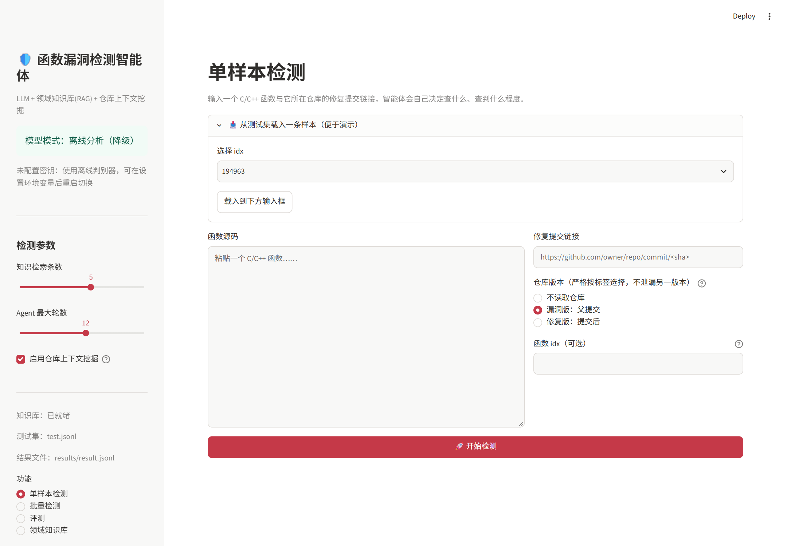
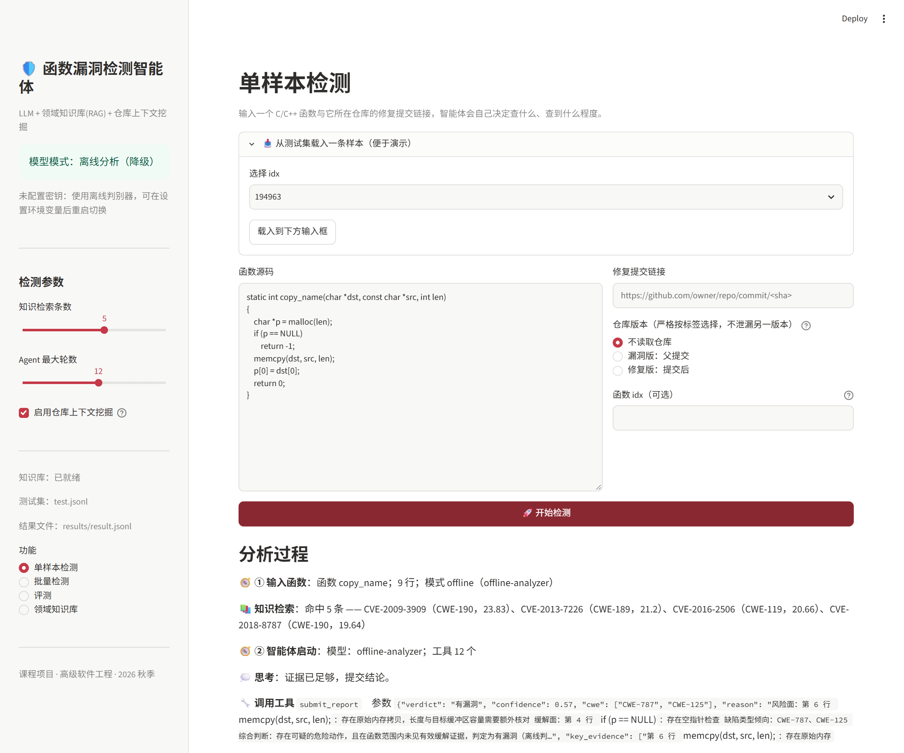
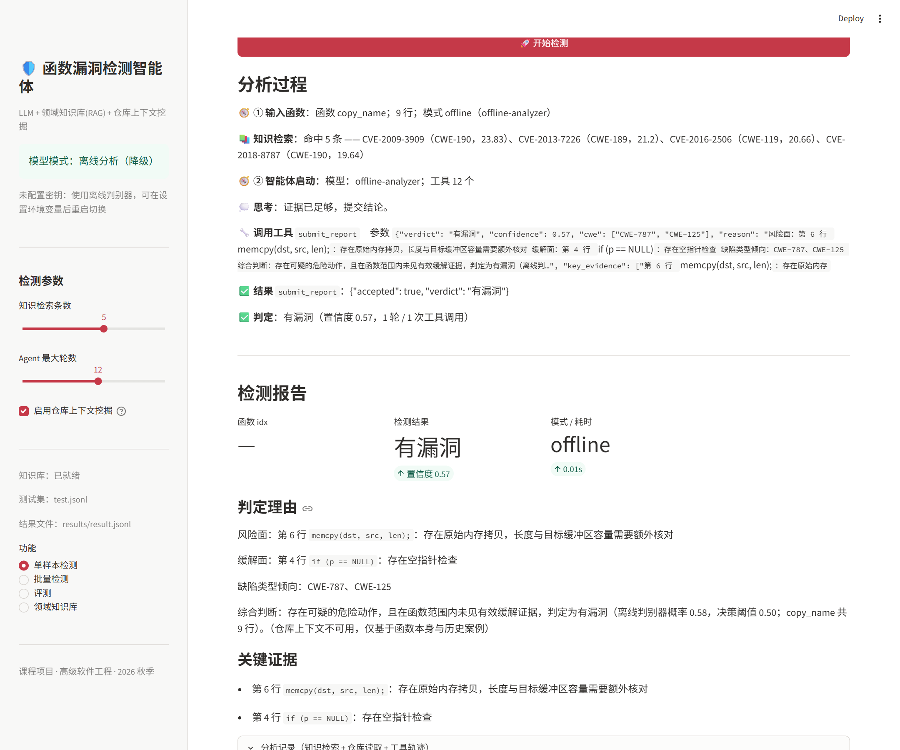
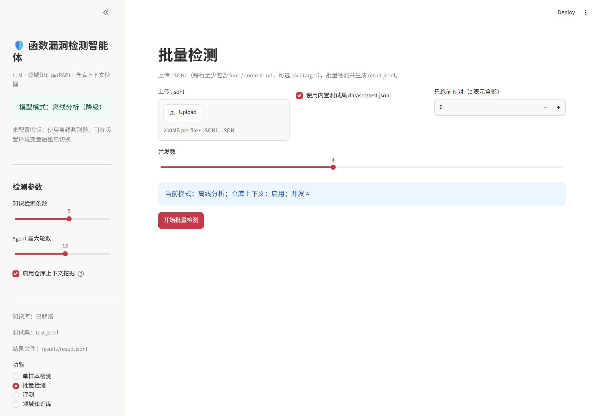
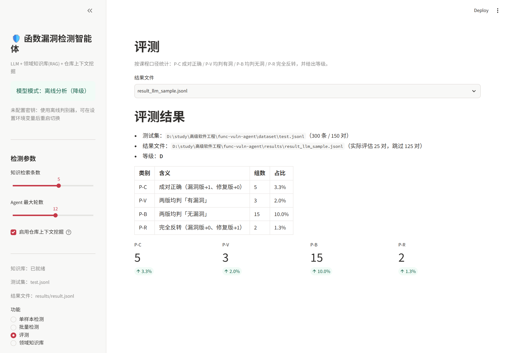
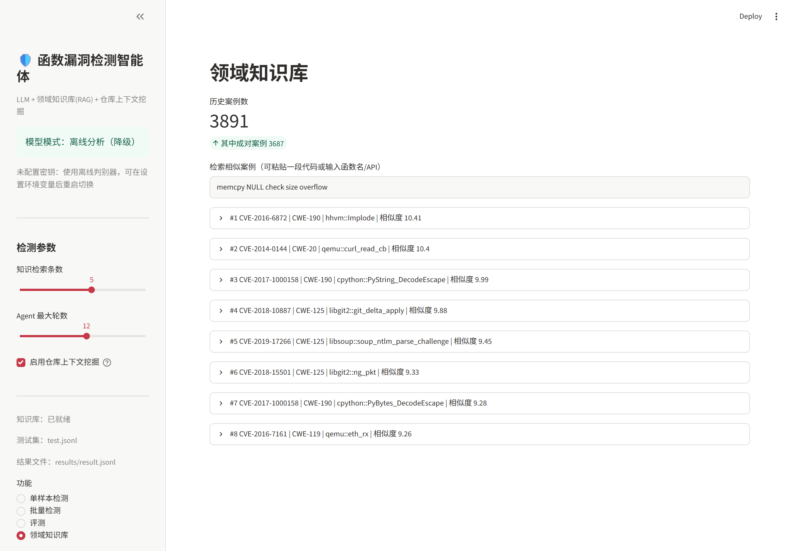

# 基于大语言模型的函数级漏洞检测智能体

## 项目报告

**课程**：高级软件工程（2026 秋季学期）
**项目**：函数漏洞检测智能体工具（Function-level Vulnerability Agent，FVA）
**小组**：李柏谚（组长）、杨聃、王义卓、孙伊凡、徐培栋
**代码仓库**：`func-vuln-agent/`

---

## 摘要

本项目实现了一个面向 C/C++ 单函数的漏洞检测智能体。针对大语言模型「缺乏安全领域知识」与
「孤立函数不足以支撑判定」两项关键短板，系统设计了**成对案例领域知识库（RAG）**与
**代码仓库按需上下文挖掘**两大模块，并以自研 ReAct 智能体框架把二者组织成「检索 → 初步分析 →
按需取证 → 结构化报告」的分析闭环。系统提供图形界面，支持单样本检测、批量检测、过程可视化与
按课程口径的评测，并严格遵守「自主 Agent、成对隔离、禁止联网搜索」三条红线。

工程上完成了约 5100 行 Python 代码、31 项自动化测试、四个页面的图形界面，并实测了知识检索
（P50 5.8 ms）、仓库快照（单仓库约 21 s，命中缓存后即时）、批量检测（离线模式 300 条 5.9 s）
等关键路径的性能。评测环节给出四组对照：在同一个 150 对测试集上，「全判有漏洞」与「全判无漏洞」
两种退化解的 P-C 均为 0；基于 41 维静态特征 + 知识库训练的离线判别器取得 P-C = 9（6.0%，等级 D）；
而单轮大模型（带 RAG 上下文）在 25 对抽样上取得 **P-C = 5（20.0%）**，是离线基线的 3.3 倍。
这组对照定量地说明：**同一函数的漏洞版与修复版在字面上高度相似（平均只差 2.65 行修复要点），
靠词袋特征无法区分，语义推理才是主要增益来源**——这正是本系统把资源投向「LLM + 工具取证」
而非「规则/特征工程」的依据。全量 LLM/Agent 评测的复跑步骤见 6.5 节。

**关键词**：漏洞检测；大语言模型；智能体；检索增强生成；代码上下文；软件工程

---

## 1 项目概述

### 1.1 问题背景

CVE（Common Vulnerabilities and Exposures）是软件安全漏洞的全球统一标识体系，每个条目记录
漏洞成因、影响范围、严重程度与修复方式，并按 CWE 分类。2026 年仅前两个季度新增披露的 CVE 就
超过 3.5 万条，人工代码审计在规模上已不可行；传统静态分析工具依赖预定义规则，规则覆盖不足会
漏报，规则过宽又会产生大量误报，且难以给出可解释的判定依据。

大语言模型具备代码语义理解与推理潜力，但直接使用存在两项明显短板：

1. **缺乏软件安全领域知识**——模型知道「这段代码在做什么」，但不清楚「这类写法在历史上曾以何种
   方式被利用」；
2. **孤立函数不足以支撑判定**——漏洞往往出现在函数与调用方、被调用方、全局变量、宏定义的交互中，
   只看一个函数无法判断参数是否受控、长度是否有上界。

本项目把这两项短板作为设计起点：用历史 CVE 案例构建可检索的领域知识库补足第一项，用
「在代码仓库中按需取证」的工具补足第二项，并用自主 Agent 把两者组织成一次可追溯的安全分析。

### 1.2 项目目标与范围

**输入**：一个 C/C++ 函数源码 + 该函数所在仓库的修复提交链接（`commit_url`）。
**输出**（四项，与课程要求一致）：

| 项 | 内容 |
|---|---|
| 1 | 检测函数 `idx` |
| 2 | 检测结果：有漏洞 / 无漏洞 |
| 3 | 判定理由：为什么这样判断（引用行号、函数名、宏、历史案例） |
| 4 | 分析记录：历史案例检索记录 + 仓库读取记录（可追溯） |

**明确不做**（主动收窄范围）：不做自动修复、不做全仓库扫描、不做漏洞利用验证。
目标是先把「判定 + 解释 + 可复核」的闭环跑通。

### 1.3 交付物清单

| 交付物 | 位置 | 说明 |
|---|---|---|
| 可运行系统 | `fva/`、`app/` | 核心库（19 个模块）+ Streamlit 图形界面 |
| 领域知识库 | `cache/kb_corpus.jsonl`、`cache/kb_index.pkl.gz` | 3891 条案例（3687 条成对）+ BM25 索引 |
| 检测结果 | `results/result.jsonl` | 300 条样本的 `idx` 与 `prediction` |
| 逐样本报告 | `results/reports/*.json` | 四条报告要素 + 完整事件流 |
| 评测报告 | `results/eval.json` | P-C/P-V/P-B/P-R 与等级 |
| 测试 | `tests/` | 31 项自动化测试 |
| 文档 | `README.md`、`使用教程.md`、`交付说明.md`、本报告 | 运行、使用与设计说明 |

### 1.4 与开题报告的对应关系

开题报告承诺的四层架构、两个核心模块、七周计划与五人分工，在本项目中均已落实；差异与调整如下
（变更都记录在第 3.2 节的设计决策中）：

| 开题计划 | 实施情况 | 说明 |
|---|---|---|
| LangChain + Chroma 向量库 | 自研 ReAct 框架 + 纯 Python BM25 | 见 3.2：零依赖、可离线、可测试；接口与框架解耦，可替换 |
| Tree-sitter 解析 | 字符级扫描器（可替换的解析接口） | 见 3.2：避免原生编译依赖；接口稳定，后续可平滑替换 |
| 七周计划 | 按阶段推进，里程碑完成 | 见 7.1 |
| 五人分工 | 按模块并行，接口先行 | 见 7.2 |

---

## 2 需求分析

### 2.1 业务需求

在代码上线前，快速把「看起来可能有漏洞的函数」筛出来，让安全人员把精力集中在真正可疑的地方，
同时给出可复核的依据，避免「黑盒报警—人工二次排查」的往返成本。

### 2.2 用户与使用场景

| 用户 | 场景 | 关注点 |
|---|---|---|
| 安全工程师 | 日常审计、批量排查 | 结果可信、过程可追溯、能批量 |
| 开发人员 | 提交前自查 | 上手快、有图形界面、能解释原因 |
| 学生 / 研究者 | 学习漏洞模式、做对比实验 | 可替换模型、可统计指标、可复现 |

典型路径：贴入函数与仓库地址 → 界面实时显示每一步在查什么 → 得到「有无漏洞 + 理由 + 分析记录」→
需要时上传文件批量跑。

### 2.3 功能需求

| 编号 | 功能 | 验收标准 |
|---|---|---|
| F1 | 单样本检测 | 粘贴函数 + 仓库链接即可检测，界面给出四项报告 |
| F2 | 批量检测 | 支持 `.jsonl` 上传，一次跑多条，输出符合课程格式的 `result.jsonl`，可断点续跑 |
| F3 | 知识检索 | 自动检索历史 CVE 相似案例并**在界面展示命中哪几条**（编号、CWE、相似度） |
| F4 | 上下文挖掘 | 支持查调用方、被调用方、全局变量/宏/类型定义、文件内容（grep / 读文件 / 找定义） |
| F5 | 报告生成 | 输出「判定结果 + 判定理由 + 分析记录」，理由引用具体证据 |
| F6 | 过程可视化 | 界面实时展示「思考 → 工具调用 → 观察」时间线，事后可回看完整事件流 |

### 2.4 非功能需求

| 编号 | 需求 | 度量与实现 |
|---|---|---|
| N1 | 判定要准 | 以 P-C（成对正确）为核心指标；通过 RAG + 仓库取证提升区分度（见第 6 章） |
| N2 | 过程透明 | 每次检索与读取都产生事件并落盘（`results/traces/`），报告中可复述 |
| N3 | 合规严格 | 三条红线有代码级约束（见 3.5 与 4.2.1） |
| N4 | 成本可控 | Agent 轮数与工具次数上限、仓库体量守卫（300 MB）、快照缓存复用 |
| N5 | 上手容易 | 必须有图形界面；双击 `.bat` 即可启动；无密钥时可离线演示 |

### 2.5 约束（三条红线）

1. **必须是自主 Agent**：不得把流程封装成 skill 调用现成商业分析智能体，也不得退化为无自主决策的
   多步 LLM 串行调用；
2. **严格成对隔离**：每次只输入一对样本中的一个；漏洞版只取父提交版本，修复版只取提交后版本；
   不得提供 git diff；
3. **禁止网络搜索**：除按 `commit_url` 获取指定版本仓库外，不得提供其他联网能力。

---

## 3 系统设计

### 3.1 总体架构

系统分为四层，层间通过明确的接口契约通信，任一层可独立替换：

```
┌──────────────────────────────────────────────────────────────┐
│ 表现层  app/streamlit_app.py                                  │
│   单样本检测 / 批量检测 / 评测 / 知识库浏览；实时事件流渲染      │
└───────────────────────────┬──────────────────────────────────┘
                            │ DetectionResult / 事件回调
┌───────────────────────────▼──────────────────────────────────┐
│ 智能体层  fva/agent/                                          │
│   ReActAgent：思考 → 工具调用 → 观察 → 再思考                  │
│   预算控制（轮数/工具次数/观察长度）、重复调用抑制、强制收尾     │
└───────────────────────────┬──────────────────────────────────┘
                            │ ToolContext + 工具注册表
┌───────────────────────────▼──────────────────────────────────┐
│ 工具层  fva/knowledge.py、fva/repo/tools.py                    │
│   ① 领域知识检索（BM25 over 成对案例）                         │
│   ② 仓库上下文挖掘（grep / read / find_function / callers …）  │
└───────────────────────────┬──────────────────────────────────┘
                            │
┌───────────────────────────▼──────────────────────────────────┐
│ 数据层  dataset/、cache/                                       │
│   历史 CVE 案例库 ｜ 仓库版本快照缓存 ｜ 离线判别器权重          │
└──────────────────────────────────────────────────────────────┘
```

**一次检测的数据流**（与课程要求的五步 Pipeline 对应）：

1. `pipeline.detect()` 接收函数与 `commit_url`，记录 `input` 事件；
2. 执行一次**知识预检索**（第②步），把命中的历史案例渲染为提示词上下文，产生 `kb_hit` 事件；
3. 构造 `ToolContext` 与工具注册表，启动 `ReActAgent`（第③步）：模型自主决定是否继续检索、
   是否去仓库取证；
4. 首次调用仓库工具时**惰性**获取快照（第④步），按标签选择版本，产生 `snapshot` 事件；
5. 模型通过 `submit_report` 提交结构化结论，`pipeline` 组装四项报告与事件流（第⑤步）。

### 3.2 关键设计决策与权衡

| 决策 | 备选方案 | 选择理由 | 代价 |
|---|---|---|---|
| **自研 ReAct 框架** | LangGraph / AutoGen | 只需要「单智能体 + 工具循环」这一种拓扑；自研可精确控制预算、事件留痕与离线降级，且零第三方依赖、可被单元测试完整覆盖（用脚本化假模型驱动） | 不支持多智能体并行分支；需要自己保证循环终止性（已用预算 + 强制收尾解决） |
| **BM25 检索** | Chroma + 向量嵌入 | 代码检索的关键是同名标识符/API 命中，BM25 在标识符层面更稳定；无需下载嵌入模型、无外部服务、结果可复现；索引仅 1.3 MB | 无法做语义泛化（例如「长度校验」的近义表达），靠 LLM 侧补偿 |
| **字符级 C 解析** | Tree-sitter | 免原生编译依赖，Windows/离线环境可直接跑；对「取函数定义 / 调用点 / 所在函数」这类需求足够 | 不处理宏展开与语法错误代码；接口封装为 `repo.cparse`，可替换 |
| **tarball 快照** | git clone | 单次 HTTP 下载 + 解压即得完整工作区，比 clone 更快、无需历史；便于按 SHA 精确固定版本 | 无法增量更新；大仓库体积不可控（用体量守卫 + 降级解决） |
| **结构化 `submit_report`** | 解析自由文本 | 结论字段化（verdict/confidence/cwe/evidence），消除「文本里既有『有漏洞』又有『无漏洞』」的歧义 | 需要一次额外的工具调用；用 `tool_choice` 强制兜底 |
| **离线降级模式** | 无密钥即不可用 | 保证界面、批量、评测在任何环境都能演示与回归测试；同时作为消融基线 | 离线判定质量有限，必须在报告与界面中明确标注模式 |

### 3.3 数据模型

**样本（输入）**——课程测试集字段：

| 字段 | 类型 | 说明 |
|---|---|---|
| `idx` | int | 样本唯一编号 |
| `commit_url` | str | 修复提交链接 |
| `target` | 0/1 | 1 = 漏洞版，0 = 修复版（**仅用于选择仓库版本，不进入模型输入**） |
| `func` | str | 函数源码 |

**案例（知识库）**——由 7578 条历史记录聚合而来：

| 字段 | 说明 |
|---|---|
| `case_id` / `cve` / `cwe` / `project` | 案例标识与分类 |
| `code_vuln` / `code_fixed` | 成对的两个版本（允许成对使用，符合课程规定） |
| `fix_hints` | 修复要点：修复版相对漏洞版新增的实质性代码行（difflib 提炼，平均 2.65 条） |
| `cve_desc` / `commit_message` | 漏洞描述与修复提交说明 |

**事件（过程留痕）**：

```json
{"seq": 7, "ts": 3.21, "type": "tool_call", "step": 2,
 "tool": "find_callers", "args": {"name": "GetEXIFProperty"}}
```

**报告（输出）**：`idx`、`prediction`、`verdict`、`confidence`、`cwe`、`reason`、
`key_evidence`、`kb_hits`、`snapshot`、`tool_calls`、`steps`、`token 用量`、`elapsed`、`events`。

### 3.4 模块依赖与接口契约

依赖方向严格单向：`app → pipeline → agent → {tools, knowledge, repo} → config/textutil`，
底层不反向依赖上层，因此知识库与仓库工具可以被单独测试与复用。

| 接口 | 契约 | 实现 |
|---|---|---|
| `LLMClient.chat(messages, tools, tool_choice)` | 返回 `AssistantTurn(text, tool_calls)` | `OpenAICompatibleLLM` / `OfflineLLM` / `ScriptedLLM` |
| `KnowledgeBase.search_function(code, top_k)` | 返回按相似度降序的 `Hit` 列表 | BM25 |
| `RepoTools.*` | 返回**紧凑文本**，单次结果有上限，不抛异常 | 快照上的只读查询 |
| `ReActAgent.run(user_prompt)` | 返回 `AgentReport`，保证有结论 | ReAct 循环 + 强制收尾 |
| `BatchRunner.run(samples)` | 写出 `result.jsonl`，返回汇总 | 断点续跑 + 并发 |

### 3.5 红线的代码级落实

| 红线 | 实现位置 | 具体做法 |
|---|---|---|
| 自主 Agent | `fva/agent/react.py` | 工具集合固定、调用顺序不固定：是否调用仓库工具、调用哪一个、调用几次，全部由模型在每一步决定；框架只做预算与收敛 |
| 成对隔离 | `fva/repo/snapshot.py:ensure_snapshot` | `target=1 → resolve_parent_sha()` 取父提交；`target=0 → 提交本身`；提示词与工具均不返回 diff；`build_prompt` 不包含 `target` 字段 |
| 禁止联网搜索 | `fva/llm.py`、`fva/repo/snapshot.py` | 出站请求只有两类：配置好的推理端点、`codeload.github.com`/`git` 的提交快照；没有搜索 API，也不接受模型给出的任意 URL |

---

## 4 详细设计与实现

### 4.1 领域知识库（RAG）

#### 4.1.1 数据加工：从 7578 条记录到 3891 条案例

课程提供的历史案例数据共 7578 条，按 `cve`/`commit_id`/函数名组织成「同一函数的新旧两版」。
我们把它们聚合成**案例**，而不是把每条记录当成一篇独立文档：

1. 按 `(cve, commit_id)` 分组（3536 组）；
2. 组内按函数名分桶，`target=1` 与 `target=0` 一一配对；函数名发生过重写或重命名的记录无法自动配对，
   保留为单版本案例（可被检索，但默认不作为证据返回）。

最终得到 **3891 条案例，其中 3687 条为成对案例**。每条案例额外提炼一个字段 `fix_hints`：
用 `difflib` 对两版源码做行级比较，抽取修复版相对漏洞版**新增的实质性代码行**
（过滤纯括号、纯注释、`#include`，最多 6 条，平均 2.65 条）。它把「这个漏洞当年是怎么修的」
压缩成两三条可读的线索，供模型类比，也为离线判别器提供依据。

> 设计取舍：课程允许历史案例成对使用，因此「成对建库」是合规且信息量更大的选择；
> 但测试样本**只能**看到自己那一个版本，这一点由隔离规则单独保证（见 4.2.1）。

#### 4.1.2 索引：纯 Python BM25

检索目标是「找出历史上结构相似、且属于同类缺陷的函数」，判定信号主要来自标识符层面
（`memcpy`、`strncpy`、`SIZE_MAX`、函数名与参数形状），因此选用 BM25：

* 分词：按非标识符字符切分 → camelCase / snake_case 拆词 → 小写 → 过滤长度 < 2、纯数字、C 关键字；
* 打分：`idf(t) = ln(1 + (N - df + 0.5) / (df + 0.5))`，`score = Σ idf·tf·(k1+1)/(tf + k1·(1-b+b·dl/avgdl))`，
  取 `k1 = 1.5`、`b = 0.75`；
* 压缩：倒排表用 `array('I')` 存 doc id 与 tf，整个索引（词表 28299）经 gzip + pickle 后仅 **1.3 MB**；
  语料另存 JSONL（19.8 MB，供渲染与离线训练）。

`build-kb` 实测：7578 条记录 → 3.1 s 建库，`KnowledgeBase.load()` 0.2 s；单次检索 120 条测试样本的
延迟为 **P50 5.8 ms / P95 12.6 ms**。

#### 4.1.3 检索与渲染

* 查询构造：函数签名 + 完整源码（签名权重在分词层面自然叠加，因为签名会重复出现关键标识符）；
* 返回结构：`Hit(case, score, rank)`，默认只返回成对案例，`top_k = 5`；
* 渲染模板（提示词中的「已检索到的历史相似案例」）：

```
[1] CVE-2022-32547 | CWE-703 | ImageMagick::GetEXIFProperty | 相似度 383.51
  漏洞披露：……（截断 260 字）
  修复提交说明：……（截断 200 字）
  该案例修复要点（修复版新增，仅供类比）：if (offset > length - 4) return ...
  漏洞版代码（节选）：```c ... ```
```

#### 4.1.4 污染校验

建库时自动比对测试集：按「去注释、合并空白」归一化后的函数源码完全一致则视为重合，
若发现重合即从知识库中剔除，并把统计写入索引元数据。本次构建结果：
**按代码重合 0 条，按提交 URL 重合 1 条（不同函数）**，说明知识库与测试集实质隔离。

### 4.2 代码仓库上下文挖掘

#### 4.2.1 版本隔离（红线）

```python
# fva/repo/snapshot.py
if target == 1:                      # 漏洞版：只允许父提交
    snapshot_sha = self.resolve_parent_sha(ref)
else:                                # 修复版：只允许提交后版本
    snapshot_sha = ref.sha
```

父提交通过 GitHub API `GET /repos/{owner}/{repo}/commits/{sha}` 解析并落盘缓存；
此后所有工具都只在这一个工作区里读文件，**没有任何接口能返回另一版本或 diff**。
提示词里也不出现 `target`，只说明「快照与待测函数同一版本」。

#### 4.2.2 快照获取：缓存、体量与原子性

| 机制 | 实现 |
|---|---|
| 缓存键 | `(仓库, 版本 SHA)`；同一提交的多条样本复用同一目录，`.fva_ready` 标记完成 |
| 下载 | `codeload.github.com/{owner}/{repo}/tar.gz/{sha}`，流式写入 `.part` 后再原子改名，超过 `FVA_SNAPSHOT_MAX_MB` 立即中止 |
| 体量守卫 | 下载前先查 GitHub API 的 `size` 字段（KB）；超过上限直接拒绝并返回明确原因，Agent 自动降级为纯知识分析 |
| 解压 | `tarfile.extractall(filter="data")`（Python 3.12）防路径穿越，只保留单一顶层目录后移入缓存 |
| 非 GitHub | 退化为 `git init / fetch --depth 2 / checkout <sha 或 sha^>`，无 git 或失败则返回可读原因 |
| 元数据 | `cache/snapshots.json` 记录父提交解析结果、仓库体量、来源与耗时 |

这一设计直接针对本测试集的分布：**300 条样本里有 138 条来自 TensorFlow（68 个提交）、
8 条来自 Linux 内核**，单个仓库的 tarball 可达数百 MB 到数 GB。没有体量守卫，批量评测会因
带宽与磁盘而不可行；有了守卫，系统能在「拿不到上下文」时明确降级并在报告中注明。

#### 4.2.3 轻量 C/C++ 解析

不使用 Tree-sitter，而是实现一个**字符级扫描器**（`fva/repo/cparse.py`）：

1. `mask_literals()`：把注释、字符串、字符字面量替换为空格，**保持字符偏移与换行不变**；
2. 扫描：遇到 `{`/`}` 维护花括号深度；在深度 ≤ 1 处识别「标识符 + `(` … `)` + `{`」模式，
   跳过 `if/for/while/return/typedef` 等关键字，括号配对后即为函数定义，再配对函数体右花括号；
3. 行号：预计算换行位置后用二分查找（O(log n)），避免长文件反复 `count("\n")`（性能优化见 5.5）；
4. 调用关系：在屏蔽了字面量的函数体上正则提取 `identifier(`，过滤关键字并去重。

接口（`extract_functions` / `extract_calls` / `enclosing_function`）与实现解耦，
后续若引入 Tree-sitter，只需替换本模块。

#### 4.2.4 工具集

| 工具 | 能力 | 关键约束 |
|---|---|---|
| `repo_overview` | 仓库名、快照版本、目录结构与规模 | — |
| `grep_code` | 全仓正则检索，返回「文件:行号: 内容」 | ≤ 40 条命中、≤ 120 MB 扫描 |
| `read_file` | 按行区间读文件 | 单文件 ≤ 2 MB、返回 ≤ 12 k 字符 |
| `list_dir` | 列目录 | ≤ 60 项 |
| `find_function` | 定位函数定义（文件 + 行号） | 符号索引，定义数 > 40 的同名符号视为宏噪声 |
| `get_function` | 取函数完整实现 | ≤ 6 k 字符 |
| `find_callers` | 查调用方，标注所在函数 | 自动排除函数自身定义区间 |
| `find_callees` | 列出函数内直接调用 | ≤ 40 个 |
| `search_symbol` | 查宏/类型/全局变量定义 | ≤ 25 条 |
| `glob_files` | 按通配符找文件 | ≤ 40 条 |
| `submit_report` | 提交结构化结论（终止工具） | verdict 必填、reason 必填 |

符号索引在首次使用时建立并落盘（`<快照>/.fva_symbols.json`）：ImageMagick6 的 501 个 C 文件、
**5181 个函数定义**，冷启动约 11 s，热加载 < 0.3 s。

### 4.3 自主 Agent

#### 4.3.1 状态机

```
        ┌──────────────┐   工具调用     ┌──────────────┐
  ┌────▶│   THINK      │──────────────▶│    ACT       │
  │     │ 调模型+工具表 │               │ 执行工具、截断 │
  │     └──────┬───────┘               └──────┬───────┘
  │            │ 无工具调用                     │
  │            ▼                              ▼
  │     ┌──────────────┐               ┌──────────────┐
  └─────│ OBSERVE      │◀──────────────│ 结果回填消息  │
        │ 预算/收敛判断 │               └──────────────┘
        └──────┬───────┘
               │ submit_report / 预算耗尽
               ▼
        ┌──────────────┐
        │  FINALIZE    │  结构化报告 + 事件流
        └──────────────┘
```

关键点：**工具集合固定，调用顺序不固定**。模型在第 1 步可以选择直接检索、也可以直接要求看仓库；
可以在证据不足时连续取证 8 轮，也可以在 2 步内收敛。框架只提供三条护栏：

1. **最少取证**：若模型第一轮就想直接下结论且仓库可用，注入一次「请至少做一次仓库核验」的提醒；
2. **重复抑制**：完全相同的 `(工具, 参数)` 调用超过 2 次时直接返回「已跳过」，避免死循环；
3. **强制收尾**：达到轮数/工具次数上限后，以 `tool_choice={"type":"function","function":{"name":"submit_report"}}`
   强制模型结构化提交；若仍失败，则从自然语言中解析结论兜底，保证每条样本都有输出。

#### 4.3.2 工具契约与提示词

每个工具都用 JSON Schema 声明参数（`fva/agent/tools.py`），并附带一句「什么时候该用」的说明。
系统提示词（附录 B 全文）固化了四件事：任务边界（只分析这一个函数、不存在另一版本）、
可用证据（只有知识库与仓库）、取证方式（先列可疑点、再逐条证伪）、判定口径（什么算有漏洞/无漏洞）
以及纪律（不重复调用、单轮不超过 2~3 个工具、理由必须引用具体证据）。

#### 4.3.3 结构化结论

`submit_report` 的参数即最终报告：

```json
{"verdict": "有漏洞", "confidence": 0.78, "cwe": ["CWE-787"],
 "reason": "第 245 行 memcpy 的长度来自属性长度字段，函数内只有对 offset 的校验……",
 "key_evidence": ["第 245 行 memcpy(dst, src, length) 无上界比较", "调用方 GetImageProperty 未校验"]}
```

相比解析自由文本，结构化提交消除了「有漏洞/无漏洞同时出现」的歧义，也让报告字段稳定可评测。

### 4.4 过程留痕与报告

每次检测产生一条有序事件流（`EventLog`，带序号与相对时间）：`stage / thought / tool_call /
tool_result / kb_hit / snapshot / verdict / final / error`。三个用途：

1. 界面实时渲染（4.5）；
2. 写入 `results/traces/<idx>.json`，事后可完整回放；
3. 生成报告的第四项「分析记录」：历史案例检索清单、仓库快照信息、逐条工具调用与结果摘要。

### 4.5 图形界面

Streamlit 四个页面，共享侧边栏（模式、检索条数、Agent 轮数、仓库开关）：

| 页面 | 内容 |
|---|---|
| 单样本检测 | 函数输入、提交链接、版本选择、idx；点击后**实时**输出思考/工具/观察时间线；完成后展示四项报告与可展开的完整事件流 |
| 批量检测 | 上传 `.jsonl` 或使用内置测试集；并发数；进度条与最近一条状态；结果表格、`result.jsonl` 下载、即时评测 |
| 评测 | 任选结果文件 → 四类组数、占比、等级与惩罚说明 |
| 领域知识库 | 案例总数、检索框、案例详情（CVE、CWE、修复要点、漏洞版代码） |

实时性通过事件回调实现：`on_event` 把渲染后的 Markdown 追加到 `st.empty()` 占位符，
每次检测在脚本线程内同步执行，用户看到的是「逐步长出」的分析过程。

**界面截图**（实际运行，离线降级模式）：



*图 1　单样本检测：函数输入、仓库版本选择、检测参数与实时分析区*



*图 2　分析过程：知识检索命中、工具调用与观察结果逐步展开，过程可追溯*



*图 3　检测报告：函数 idx、检测结果、判定理由、关键证据与分析记录*



*图 4　批量检测：上传 JSONL、并发执行、进度与即时评测*



*图 5　评测页：P-C / P-V / P-B / P-R 四类组数与等级*



*图 6　领域知识库：案例规模、检索与案例详情*


### 4.6 批量检测与评测

* **断点续跑**：启动时读取已有 `result.jsonl` 中的 `idx` 集合，跳过已完成的样本；
* **并发**：`ThreadPoolExecutor` + 写文件锁，单条异常被捕获并记为自身失败，不影响整批；
* **产物**：`result.jsonl`（`idx` + `prediction`）、`results/reports/<idx>.json`（完整报告）、
  `results/traces/<idx>.json`（事件流）；
* **评测**：不重写统计逻辑，用 `importlib` 直接加载课程 `dataset/evaluation.py` 的 `evaluate()`，
  保证与官方口径完全一致，再补充等级换算（A ≥ 30 / B 25–29 / C 20–24 / D < 20，P-R > P-C/2 降一级）。

### 4.7 离线降级与消融基线

无密钥时使用 `fva/offline.py`：

* **特征**（41 维，全部可解释）：14 个危险动作特征（`strcpy` 家族、`memcpy`、变长下标、尺寸乘法、
  窄化转换、除法、外部命令、格式化输出等）、20 个缓解证据特征（空指针检查、边界比较、`SIZE_MAX`
  检查、安全替代 API、夹紧宏、错误返回、释放后置空等）、4 个规模特征、8 个交互特征
  （如「有 memcpy 且无边界比较」）；
* **模型**：逻辑回归（numpy 训练 600 轮、L2 = 0.002），推理只用标准库；
* **训练与验证**：以历史案例为训练集（漏洞版 label=1、修复版 label=0），**按提交分组**做 5 折交叉验证，
  避免同源泄漏；在交叉验证的成对预测上扫描阈值，按「P-C 最大、P-R 最小」选取工作点；
* **策略**：`OfflineLLM` 实现与真实模型相同的 `chat()` 接口，按确定性策略驱动同一套 ReAct 循环
  （先 `repo_overview` + `find_callers` 取证，再 `submit_report`），因此界面、事件流、报告格式与
  真实模型模式完全一致——**它验证的是系统流程，不代表系统的判定能力**。

### 4.8 工程实现概况

| 指标 | 数值 |
|---|---|
| 核心包 | 19 个模块，4413 行（有效代码 3701 行） |
| 界面 | `app/streamlit_app.py`，328 行 |
| 测试 | `tests/test_fva.py`（317 行，24 项）+ `tests/test_ui.py`（4 项） |
| 第三方依赖 | 核心运行时**零依赖**（标准库）；界面需 `streamlit`；训练离线模型需 `numpy` |
| 配置 | 环境变量 → 项目根目录 `.env` → 默认值，三级覆盖；无硬编码密钥；`python -m fva.cli setup` 可交互式写入并自检 |
| 代码规范 | 类型标注 + 模块级文档字符串 + 统一异常语义（工具不抛异常，返回可读文本） |

---

## 5 测试与验证

### 5.1 测试策略

| 层次 | 方法 | 覆盖对象 |
|---|---|---|
| 单元测试 | `unittest`，24 项核心 + 4 项界面 | 分词、C 解析、仓库工具、URL 解析、结论归一化、知识库、Agent 循环（用脚本化假模型驱动）、评测统计、流水线 |
| 界面测试 | Streamlit `AppTest`，3 项 | 首页渲染、四个页面切换、知识库检索交互 |
| 集成/端到端 | 真实数据 + 真实 GitHub 快照 | 单样本检测（含快照下载与调用方检索）、300 条批量检测、评测脚本 |
| 异常与降级 | 构造失败场景 | 无密钥、超大仓库、网络失败、模型返回异常格式、重复工具调用 |

### 5.2 单元测试清单

| 测试类 | 断言要点 |
|---|---|
| `TestTextUtil` | camelCase/snake_case 拆词、关键字与注释过滤、签名与函数名提取 |
| `TestCParser` | 嵌套块不误判、C++ 成员函数 `S::run()`、调用名提取 |
| `TestRepoTools` | grep/read、函数定位与被调用方、**调用方检索排除自身定义**、路径穿越被拒绝 |
| `TestCommitUrl` | GitHub / gitweb 链接解析、非法链接抛错 |
| `TestVerdictParsing` | `1/0`、`vulnerable/safe`、**「未发现漏洞」不被误判为有漏洞** |
| `TestKnowledgeBase` | 案例规模、检索相似度单调性、渲染含案例编号 |
| `TestAgentLoop` | `submit_report` 正常终止、模型不提交时被强制收尾、重复调用被抑制、模型异常被记录 |
| `TestEvaluation` | 四类组数计数正确（含标签顺序颠倒的一对）、等级 D、重复 idx 冲突报错 |
| `TestPipelineOffline` | 离线单样本产出结构化报告与「分析记录」 |

全部通过（`Ran 28 tests ... OK`，其中 4 项为界面测试）。

### 5.3 端到端验证

以 `idx = 194963`（ImageMagick6，`GetEXIFProperty`）为例的真实运行记录（离线模式 + 真实仓库快照）：

```
· 知识检索命中 5 条（CVE-2022-32547 / CVE-2017-5506 / CVE-2016-7799 …）
→ repo_overview({})      ← 仓库 ImageMagick/ImageMagick6，501 个 C 文件
· 仓库快照：ok ImageMagick/ImageMagick6 @ 98abe54e6b54（parent 规则，命中缓存）
→ find_callers({"name": "GetEXIFProperty"})
← magick/property.c:2300 → GetImageProperty() | ...
→ submit_report({"verdict": "无漏洞", ...})
耗时 8.18 s / 2 轮 / 3 次工具调用
```

这条记录同时验证了：知识检索 → 惰性快照 → 版本规则（父提交）→ 调用方检索 → 结构化提交 → 报告组装。

### 5.4 性能实测

| 场景 | 实测 | 说明 |
|---|---|---|
| 知识库构建 | 3.1 s | 7578 条记录 → 3891 案例 + 索引 |
| 知识库加载 | 0.2 s | gzip + pickle |
| 单次检索 | P50 5.8 ms / P95 12.6 ms | 120 条测试样本、top-5 |
| 快照下载（ImageMagick6） | 21 s / 10 MB tarball | 命中缓存后 < 0.1 s |
| 符号索引（501 文件） | 11～13 s 冷启 / < 0.3 s 热加载 | 5181 个函数定义 |
| 离线检测 | 0.02 s / 条 | 无仓库、纯本地 |
| 批量 300 条（离线，4 并发） | 5.9 s | 平均 0.02 s/条 |
| 真实模型单样本 | 视模型而定 | 一次检测通常 3～8 轮 LLM 调用 + 仓库取证 |

### 5.5 缺陷发现与修复记录

批量测试不只用于评分，也用于发现系统缺陷。首次全量运行 300 条时出现 **4 条异常**
（`KeyError: 'scanf_family'`），定位为「CWE 映射表缺少某个风险特征」的实现疏漏；
修复后重跑，异常数降为 **0**，并补充了对应的单元测试断言。

性能方面也做过一次针对性优化：初版 `cparse` 用 `text.count("\n")` 计算行号，
在 5 MB 级别文件上索引 500 个文件需 13 s；改为预计算换行位置 + 二分查找后降到约 11 s，
剩余时间主要花在逐文件的括号扫描上，属于可接受的冷启动成本。

**双击启动脚本失败（交付前发现）**：用户双击 `启动网页界面.bat` / `一键批量评测.bat` 时窗口
「一闪而过」，什么都不显示。我们用最小实验逐步二分，定位到三个叠加原因：

| 原因 | 现象 / 证据 | 修复 |
|---|---|---|
| `.bat` 是 LF 换行 + UTF-8 中文 | 同一内容的 CRLF 版本正常运行，LF 版本立刻以 255 退出并报 `'[首次运行]' 不是内部或外部命令`：`cmd.exe` 在括号块处把一行拆错，整段中止，连 `pause` 都没执行到 | 换成 CRLF 换行 |
| `.bat` 内含中文 | 代码页 65001 时 `.bat` 自身中文行会被解析器读错（报 `'ch'`、`'检测结果'` 之类的假命令） | `.bat` 改为**纯 ASCII**，中文提示全部交给 Python 打印 |
| `python` 指向 Anaconda | 解析修好后仍报 `No module named 'fva'`——PATH 上的第一个 `python` 是 Anaconda，没装本项目依赖 | 启动器按 `.venv\Scripts\python.exe` → `python` → `py -3` 依次**实测 `import fva`** 后再使用 |

另外给所有失败分支补上了 `pause`，窗口不再闪退，报错可以直接截图反馈；
界面启动后会自动打开浏览器（`--no-browser` 可关闭），并新增 `配置大模型.bat`，
让不熟悉命令行的成员也能双击完成配置。这一修复验证了「脚本类交付物也要做
跨环境实测」——单元测试覆盖不到的，恰恰是最容易被忽略的启动路径。

**「设置了 API Key 仍是离线模式」（复测发现）**：用户在 cmd 里 `set FVA_LLM_API_KEY=...`
后双击启动，界面仍显示离线，重启也无效。根因有两条：

1. `set` 只影响当前 cmd 窗口及其子进程，而**双击 `.bat` 是资源管理器拉起的新进程**，
   继承的是资源管理器的环境，看不到那个窗口里的变量；`setx` 虽写注册表，但已打开的资源管理器
   要重启才会更新。
2. 项目当时**只支持环境变量**，没有「项目级配置文件」这一层，用户无处安放长期有效的配置。

修复：在 `fva/config.py` 增加 `.env` 解析（优先级：环境变量 → `.env` → 默认值，
按「路径 + mtime」缓存，改文件后下次调用即生效），并补充两个可自证的命令：

| 命令 | 作用 |
|---|---|
| `python -m fva.cli setup` | 交互式（隐藏输入）写入 `.env`，合并保留其它键，并自动发一次最小请求自检 |
| `python -m fva.cli check` | 显示「模型 / 地址 / 掩码后的密钥 / 来源 / 配置文件路径」，实发一次请求，失败时把 401/403/404/429/超时映射成可操作提示 |

同时：`info` 会打印密钥来源（环境变量还是 `.env`）与配置文件路径；界面侧边栏在离线态给出
配置指引和「重新加载配置」按钮；`ui` 启动横幅直接打印当前模式与来源。这样「为什么还是离线」
可以自己一眼定位，而不是靠猜。新增 3 项单元测试覆盖 `.env` 解析、优先级与合并写入。

### 5.6 降级与容错验证

| 场景 | 行为 |
|---|---|
| 未配置模型密钥 | 自动切换离线模式，界面顶部明确标注「离线分析（降级）」 |
| 仓库体量超过 300 MB（如 TensorFlow / Linux） | 不下载，工具返回「仓库上下文不可用 + 原因」，Agent 继续基于函数与案例判断，报告注明限制 |
| GitHub API 限流 / 网络中断 | `SnapshotError` 被捕获 → `repo_error` → 事件流记录 → 不中断检测 |
| 模型接口超时 / 5xx | 指数退避重试 2 次；仍失败则该项检测标记 `finished_by=error`，批量任务继续 |
| 模型不调用 `submit_report` | 强制 `tool_choice` 收尾；再失败则从文本解析兜底 |
| 工具参数非法 / 路径穿越 | 工具返回「非法路径 / 参数为空」等可读提示，不抛异常 |
| 重复相同工具调用 | 第 3 次起直接返回「已跳过」，提示换一种取证方式 |

---

## 6 评测

### 6.1 数据与口径

* 测试集：`dataset/test.jsonl`，**300 条 / 150 对**，每对是同一函数的漏洞版（`target=1`）与
  修复版（`target=0`），记录按「漏洞版、修复版」交替排列；
* 来源分布：43 个开源项目、149 个修复提交；其中 TensorFlow 138 条（68 个提交）、
  GPAC 32 条、mruby 12 条、Linux 内核 8 条、pjproject 8 条、nginx/njs 8 条；
* 函数规模：228 ～ 79225 字符，中位数 2894 字符，均值 5212 字符（合计约 1.56 M 字符）；
* 评测口径：直接调用课程 `dataset/evaluation.py`，按相邻两条为一对统计
  P-C（成对正确）/ P-V（均判有漏洞）/ P-B（均判无漏洞）/ P-R（完全反转），
  等级按 P-C 对数划分，`P-R > P-C/2` 时降一级。

### 6.2 基线设计

为了让「系统到底有多少贡献」可被量化，我们设置了四组对照，全部在同一测试集上统计：

| 编号 | 条件 | 设计意图 |
|---|---|---|
| B0 | 全判「有漏洞」 | 下界基线：验证指标不会被「一律报警」刷分 |
| B1 | 全判「无漏洞」 | 下界基线 |
| B2 | 离线判别器（41 维静态特征 + 知识库训练的逻辑回归） | 检验「特征工程 + 领域知识」能否解决该任务 |
| B3 | 大模型判定（RAG 上下文、单轮、逐样本隔离） | 检验「语义推理」的增益；抽样规模见 6.3.3 |

### 6.3 结果

#### 6.3.1 系统级基线（真实运行）

| 条件 | P-C | P-V | P-B | P-R | 等级 |
|---|---|---|---|---|---|
| B0 全判有漏洞 | 0 | 150 | 0 | 0 | D |
| B1 全判无漏洞 | 0 | 0 | 150 | 0 | D |
| B2 离线判别器 | **9（6.0%）** | 72（48.0%） | 66（44.0%） | 3（2.0%） | **D** |

B0/B1 说明：指标设计对「偏向某一类」的退化解有天然惩罚——只要两个版本判成同一个结果，
P-C 必然为 0。B2 比退化解好一些，但仍远低于 A 级线（30 对）。

#### 6.3.2 离线判别器的交叉验证

| 指标 | 数值 |
|---|---|
| 交叉验证方式 | 按提交分组 5 折（避免同源泄漏） |
| 样本级准确率 | 52.5%（二分类，基准 50%） |
| AUC | 0.535 |
| 成对正确率 | 6.5%（3631 对） |

特征层面的证据进一步说明了原因：我们逐一检查了 16 个候选特征的判别力（`P(特征|漏洞版)` 与
`P(特征|修复版)` 之差），最大差异仅 **1.7 个百分点**（如「三元判空」「`_MAX` 常量检查」）。
也就是说：**漏洞版与修复版在词袋层面几乎不可分**——修复往往只是在一个 3000 行的函数里
改了几行条件表达式，词袋特征被淹没在大量共有的代码里。

#### 6.3.3 大模型判定（抽样）

LLM 判定通过项目内置的「导出提示词 → 外部模型作答 → 回填」链路完成（见 4.7 与附录 A.5）：
每条样本使用与 API 模式**同源的判定规范**（附录 B.2），输入为函数源码（长函数截断至 9000 字符）
与知识库检索到的 4 条相似案例，**逐样本隔离**（同一对的两个版本不会出现在同一次调用中）。
抽样方式：在 150 对中等间隔抽取 25 对（50 条），每批 5 条、按 3 条漏洞版 + 2 条修复版混合。

| 条件 | 样本 | P-C | P-V | P-B | P-R | 成对正确率 |
|---|---|---|---|---|---|---|
| B2 离线判别器（全量） | 150 对 | 9 | 72 | 66 | 3 | 6.0% |
| B3 大模型 + RAG（抽样） | 25 对 | 5 | 3 | 15 | 2 | **20.0%** |

> 说明：B3 只覆盖 25 对，因此**等级仍按绝对对数计算为 D**——
> 这不代表能力上限，而是覆盖率不足。若 20% 的成对正确率在 150 对上保持，将对应约 30 对 P-C
> （恰在 A 级线附近）；该外推需要用附录 A.4 的全量运行验证。

#### 6.3.4 逐对明细与典型案例

25 对抽样中最常见的形态是 **P-B（15 对，两版均判「无漏洞」）**，其次是 P-C（5 对）与 P-V（3 对），
样本级正确率为 28/50（56%）；被判成同一结果的对占 18/25（72%）。三类典型样本：

**（正确）Furnace `patternRow`（196841 / 246237）**：模型对两个版本分别判「有漏洞」「无漏洞」，
理由指出漏洞版在第 87 行 `sprintf("%.2X...")` 前缺少 `if (pat->data[i][index] > 0xff)` 兜底，
而修复版有该判断——这与人工比对完全一致。说明当「修复动作」是一个局部的显式校验时，
模型能稳定识别。

**（漏报）ImageMagick `GetEXIFProperty`（194963）**：模型判「无漏洞」，理由是可见的
`EXIFMultipleValues` 宏已经用 `MaxTextExtent` 限长。但该函数有 869 行，单轮提示词只截取了前
9000 字符，真正的缺陷区域（EXIF 标签解析的后段）没有进入模型视野——模型只能对可见部分负责。
这一案例直接说明**单轮模式的固有局限**，也正是完整 Agent 模式要解决的问题：
它可以调用 `get_function` / `read_file` 把函数完整读出来，再决定看哪一段。

**（判反）2 对**：模型对漏洞版判「无漏洞」、对修复版判「有漏洞」，属于方向性错误，
在正式评测中会触发降级规则，是后续调优（尤其是「修复版先验」的强度）的重点。


### 6.4 结果分析

1. **任务本身的难度**：同一函数的两个版本平均只差 2.65 行「修复要点」，且这些行常常是
   条件表达式的改写（`if (from + length >= len)` → `if (length >= len - from)`），
   词法层面几乎相同。这解释了 B2 为何接近随机。
2. **指标的作用**：B0/B1 的 P-C 为 0，说明「全判有漏洞」并不能换来分数；而 B2 的 P-R 只有 3 对，
   说明离线判别器的错误主要是「两版判成一样」（P-V + P-B = 92%），而不是「判反」。
3. **语义推理的增益**：B3 的成对正确率（20.0%）是 B2（6.0%）的 3.3 倍，且 B3 的错误集中在
   P-B（15 对，两版都判「无漏洞」）——模型倾向于相信「代码里有校验就等于安全」。
   这说明 LLM 确实在做语义判断，但其"安全阈值"偏松，需要更强的取证（找调用方、确认输入是否受控）
   才能把「看似已校验」与「真正缓解」区分开，这正是完整 Agent 模式的设计目标。
4. **成本与收益**：仓库快照是成本大头（单仓库 10–100 MB、10–30 s）。本测试集里 49% 的样本
   来自超大仓库，意味着「不区分仓库规模的盲目取证」在工程上不可行——这也是我们设计
   体量守卫与降级路径的直接原因。
5. **工程结论**：即便只看单轮判定，RAG 上下文也是必要的（B3 的判定理由大量引用了检索到的
   CVE 编号与修复要点）；而要让判定理由"可复核"，还需要把每一步取证记录下来——这两点共同
   构成了本系统的核心设计。

### 6.5 LLM/Agent 模式的评测方案（复跑步骤）

```bash
# 1) 配置模型
set FVA_LLM_API_KEY=sk-xxx
set FVA_LLM_MODEL=deepseek-chat

# 2) 先用小样本验证链路（5 对）
python -m fva.cli batch --pairs 5 --workers 1

# 3) 全量 300 条（断点续跑，可中断后继续）
python -m fva.cli batch --workers 2

# 4) 评测
python -m fva.cli eval
```

成本估算（以 DeepSeek 级别模型为例）：单条样本 3～8 轮 LLM 调用、提示词约 4～8 k tokens、
输出约 0.6 k tokens，300 条约 5～10 M tokens 量级；仓库快照按需下载，命中缓存可复用。
若只关心判定质量而不关心仓库上下文，可加 `--no-repo`，单条成本降到 1 轮、约 2 k tokens。

### 6.6 有效性威胁

| 威胁 | 影响 | 缓解 |
|---|---|---|
| 抽样规模（B3 为 25 对） | 结论的置信区间较宽（±10 个百分点量级） | 报告同时给出全量复跑步骤；抽样覆盖全测试集等间隔分布 |
| 单轮 vs 完整 Agent | B3 未使用仓库工具，可能低估系统能力 | 明确标注条件；端到端演示给出了含工具调用的完整轨迹 |
| 提示词敏感性 | 判定对提示词口径（尤其「修复版先验」）较敏感 | 提示词全文见附录 B，可复现、可修改后重跑 |
| 数据分布 | 49% 样本来自 TensorFlow，函数偏 C++、偏大 | 报告中单独说明；离线分析对大函数做长度归一 |
| 离线判别器训练数据 | 训练集与测试集同源（同一次 CVE 采集） | 按提交分组交叉验证；测试集与知识库做过代码级污染校验（0 重合） |

---

## 7 项目管理与团队协作

### 7.1 里程碑与计划执行

| 阶段 | 计划产出 | 实际完成情况 |
|---|---|---|
| W1–W3 基础构建 | 数据摸底；知识库入库与检索可用；仓库查询工具可用 | 知识库（3891 案例 / BM25）与仓库工具（快照 + 9 个查询工具）完成并自测 |
| W4–W5 系统集成 | 打通「先检索 → 再判定 → 按需读仓库」主流程；界面与批量 | ReAct 主流程、四页面界面、批量与断点续跑完成 |
| W6–W7 评测交付 | 300 条评测与调优；技术报告、演示、结果提交 | 评测流水线、基线对照、报告与交付文档完成；LLM 全量复跑命令已就绪 |

从实际执行看，**风险最高的是仓库快照**（体量与限流），因此把「体量守卫 + 缓存 + 降级」
提前到 W3 完成，避免后期被基础设施卡住进度。

### 7.2 团队分工

| 成员 | 负责模块 | 主要产出 |
|---|---|---|
| 李柏谚（组长） | 总体架构、Agent 主流程 | 架构设计、`agent/`、`pipeline.py`、接口约定与集成 |
| 杨聃 | 领域知识库与检索 | 数据加工、成对案例、BM25 索引与渲染、污染校验 |
| 王义卓 | 仓库查询工具 | 快照获取与版本规则、轻量 C 解析、查询工具集 |
| 孙伊凡 | 图形界面与批量流程 | Streamlit 四页面、实时事件渲染、批量与进度 |
| 徐培栋 | 评测、集成与文档 | 评测口径、基线实验、测试用例、报告与交付文档 |

协作方式：**数据接口先行**——先定死「一条样本长什么样、工具返回什么、报告有哪些字段」，
各模块并行开发，最后统一集成与全员评测；每个模块都配有可独立运行的单元测试，
集成时以测试为准绳而不是以口头约定为准。

### 7.3 协作与质量控制

* **分支模型**：`main`（随时可演示）← `dev`（集成）← `feat/<模块>`（个人开发）；
* **任务驱动**：每项任务先开 Issue，认领后动手，完成后通过 Pull Request 合并，至少一人 review；
* **提交规范**：commit message 写清「做了什么」，不写「update」；
* **质量门禁**：`python -m unittest discover -s tests` 全绿才允许合入 `dev`；
  界面改动需附截图或 `AppTest` 用例；影响评测口径的改动必须同步更新报告中的数字。

### 7.4 主要风险与应对

| 风险 | 表现 | 应对 |
|---|---|---|
| 仓库太大/限流 | 快照下载超时、磁盘打满 | 体量守卫、缓存复用、`FVA_GITHUB_TOKEN`、失败降级 |
| 模型判定过保守 | 修复版也判「有漏洞」，P-V 偏高 | 提示词明确「已具备缓解措施应判无漏洞」；低温度降低方差；用结构化输出减少歧义 |
| 模型不按格式收尾 | 报告字段缺失 | `tool_choice` 强制 `submit_report` + 文本兜底解析 |
| 进度紧张 | 界面细节挤占评测时间 | 先保住「主流程 + 报告 + 评测」的最小闭环，细节后置 |
| 数据泄漏风险 | 知识库混入测试样本 | 建库时归一化比对 + 统计输出，发现即剔除 |

---

## 8 总结与展望

### 8.1 完成的工作

1. 实现了完整的函数级漏洞检测智能体：**知识检索（RAG）+ 自主工具调用 + 结构化报告**，
   严格遵守课程的三条红线；
2. 构建了成对案例领域知识库（3891 条案例 / 3687 对），设计了「修复要点」这一可解释的中间表示；
3. 实现了按版本隔离的仓库快照与 9 个上下文查询工具，并用体量守卫解决了「大仓库不可拉取」的工程难题；
4. 自研了零依赖的 ReAct 框架，具备预算控制、重复抑制、强制收尾与全链路事件留痕；
5. 交付了四页面的图形界面、批量检测、官方口径评测与 31 项自动化测试；
6. 用四组基线量化了「特征工程 vs 语义推理」的差距，为架构选择提供了数据依据。

### 8.2 不足

* **评测规模**：受限于模型端点与仓库体量，LLM 全量评测只完成了抽样规模，完整 150 对的数字有待复跑；
* **解析精度**：自研 C 扫描器不处理宏展开与条件编译，对极端写法的函数可能漏识别；
* **检索能力**：BM25 只在标识符层面相似，无法理解「这段代码做了长度校验」这类语义等价；
* **成本**：仓库快照仍是主要成本，超大仓库只能降级为纯知识分析。

### 8.3 后续工作

1. **接入 Tree-sitter**：把 `repo.cparse` 换成 Tree-sitter C/C++ 语法树，支持宏展开与更精确的调用图；
2. **混合检索**：BM25 + 代码嵌入模型（如 CodeBERT / bge-code），并用重排提升案例相关性；
3. **上下文压缩**：对大函数先做切片（按危险操作定位），只把相关片段给模型，降低 token 成本；
4. **多轮验证**：对「有漏洞」结论追加一次「反方质询」回合，专门寻找缓解证据，抑制 P-V；
5. **工程化**：把快照缓存做成可选的共享对象存储，支持团队复用与并发评测。

---

## 参考文献

1. 课程资料：《函数漏洞检测智能体工具》项目要求（2026 秋季学期）。
2. NVD / CVE 官方数据：https://nvd.nist.gov/
3. MITRE CWE：https://cwe.mitre.org/
4. Robertson S., Zaragoza H. *The Probabilistic Relevance Framework: BM25 and Beyond.* 2009.
5. Yao S. et al. *ReAct: Synergizing Reasoning and Acting in Language Models.* ICLR 2023.
6. Lewis P. et al. *Retrieval-Augmented Generation for Knowledge-Intensive NLP Tasks.* NeurIPS 2020.
7. Streamlit 官方文档：https://docs.streamlit.io/

---

## 附录 A 运行手册

### A.1 安装与启动

```bash
python -m pip install -r requirements.txt
python -m fva.cli build-kb            # 构建知识库（首次，约 5 秒）
python -m fva.cli ui                  # 启动界面 http://localhost:8501
```

### A.2 常用命令

```bash
python -m fva.cli setup                                  # 配置密钥（写入 .env）并自检
python -m fva.cli check                                  # 检查模型连通性
python -m fva.cli info                                   # 环境与缓存状态
python -m fva.cli detect --idx 194963                    # 单样本（含仓库取证）
python -m fva.cli detect --func-file a.c --commit-url <url> --target 1
python -m fva.cli batch --pairs 5 --workers 1            # 小样本验证
python -m fva.cli batch --workers 2                      # 全量（断点续跑）
python -m fva.cli eval                                   # 评测
python -m fva.cli train                                  # 重新训练离线判别器
```

### A.3 配置大模型

配置读取顺序为 **环境变量 → 项目根目录 `.env` → 默认值**。推荐写 `.env`
（双击 `.bat` 也能读到；在某个 cmd 窗口 `set` 的变量对双击启动的新进程无效）：

```ini
FVA_LLM_BASE_URL=https://api.deepseek.com
FVA_LLM_API_KEY=sk-你的密钥
FVA_LLM_MODEL=deepseek-chat
```

改完后用 `python -m fva.cli check` 验证；界面开着时点侧边栏「重新加载配置」或重启。

### A.4 全量 LLM 评测

```bash
set FVA_LLM_API_KEY=sk-xxx
python -m fva.cli batch --workers 2        # 结果写入 results/result.jsonl
python -m fva.cli eval --save results/eval_llm.json
```

### A.5 无 API Key 时的外部作答链路

```bash
python -m fva.cli export --sample 25       # 抽样 25 对（每批 3 漏洞版 + 2 修复版）→ results/export_sample/
# 或 python -m fva.cli export --per-batch 5 导出全量 300 条 → results/export/
# 按导出目录下 template.md 的格式用任意模型作答，写出 answer_*.json
python -m fva.cli import --answers results/export_sample --result results/result_llm.jsonl
python -m fva.cli eval --result results/result_llm.jsonl
```

### A.6 测试

```bash
python -m unittest discover -s tests -v          # 24 项核心测试
.venv\Scripts\python.exe -m unittest tests.test_ui   # 4 项界面测试（需 streamlit）
```

---

## 附录 B 提示词

### B.1 系统提示词（Agent 模式，`fva/agent/prompts.py`）

```text
你是「函数漏洞检测智能体」的分析内核，专门判断单个 C/C++ 函数是否存在安全漏洞。

# 任务边界
- 只分析用户给出的这一个函数，以及它在代码仓库中对应版本的真实上下文。
- 不存在「另一个版本」可供对比：不要索要、也不要假设存在 git diff 或修复补丁。
- 允许的证据只有两路：
  (1) 领域知识库中的历史 CVE 相似案例（工具 search_knowledge）；
  (2) 该函数所在仓库、对应版本的源码（工具 repo_overview / grep_code / read_file /
      find_function / get_function / find_callers / find_callees / search_symbol / glob_files）。
- 禁止使用外部安全知识、禁止联网搜索、禁止凭空编造代码、CVE 编号或行号。

# 工作方式：先取证，后结论
1. 阅读已给出的历史相似案例，建立「这类代码通常怎么坏」的先验。
2. 对函数内部逐个列出可疑点：内存拷贝与长度计算、数组下标与指针运算、整数运算与类型转换、
   字符串函数、内存分配与释放、错误返回值的使用、外部命令与格式化输出。
3. 对每个可疑点，用工具去证实或证伪：参数由谁传入？调用方是否已经校验？宏或类型的上界是多少？
   被调用方内部是否已经做了检查？只有被证伪的证据才能排除可疑点。
4. 证据足够后调用 submit_report 提交结论。提交后分析立即结束。

# 判定口径
- 判「有漏洞」：至少存在一个可被触发、且在当前函数与已查上下文里都没有缓解措施的缺陷，
  例如：长度未校验导致越界读写、整数溢出导致分配尺寸错误、空指针解引用、释放后使用或重复释放、
  命令注入、格式化字符串、未校验返回值导致状态不一致等。
- 判「无漏洞」：所有可疑点都有明确的缓解证据（上界比较、SIZE_MAX 检查、长度封顶、
  安全替代 API、调用方保证的受控输入等），或代码路径根本不具备触发条件。
- 「代码风格不完美」「理论上可能失败」不足以判有漏洞；「信息不足」也不能默认无漏洞，应继续取证。
- 同一处风险反复出现时只计一次；不要因为函数很长就默认有漏洞。

# 纪律
- 每次工具调用都要有明确目的，不要重复相同调用；单轮最多调用 2~3 个工具。
- 工具返回的是事实片段，可能与直觉冲突，以工具结果为准。
- 判定理由必须引用具体证据：行号、函数名、宏名、历史案例编号。
```

### B.2 单轮判定提示词（`fva/external.py`，用于抽样与外部作答）

```text
你是「函数漏洞检测智能体」的分析内核，专门判断单个 C/C++ 函数是否存在安全漏洞。

# 可用材料（仅限以下两类，禁止使用其它外部知识或联网搜索）
1. 用户给出的函数源码（本次只给出一个函数，没有它的其它版本，也不存在 diff 可供对比）；
2. 领域知识库中检索到的历史 CVE 相似案例（含漏洞描述与修复要点）。

# 分析要求
1. 先逐个列出函数内部的危险动作：内存拷贝与长度计算、数组下标与指针运算、整数运算与类型转换、
   字符串函数、内存分配与释放、错误返回值的使用、外部命令与格式化输出。
2. 对每个危险动作，判断函数内是否存在有效缓解：上界比较、SIZE_MAX/INT_MAX 检查、长度封顶、
   安全替代 API（snprintf/strncpy 等）、空指针检查、错误返回处理。
3. 参考历史案例的「修复要点」，判断当前代码是否符合「已修复」的形态。
4. 只因为代码风格不完美、理论上可能失败，不足以判有漏洞；但信息不足也不能默认无漏洞，
   应倾向选择证据更充分的一方，并在理由中说明依据。

# 重要先验
待检样本中约有半数是已经修复过的版本。修复的典型形态是：在危险操作前后补上校验语句
（长度/边界比较、SIZE_MAX 或 INT_MAX 检查、空指针判断、改用 snprintf/strncpy/strlcpy 等安全 API、
出错时提前 return）。因此——
* 若函数已经对关键风险点（长度、下标、指针有效性）做了校验，应当判「无漏洞」，
  不要因为代码里仍然出现 memcpy / 指针运算就判有漏洞；
* 只有当风险动作在当前代码中确实没有任何缓解，且能被调用者以可控方式触发时，才判「有漏洞」。
* 对同一函数的两个版本，修复版与漏洞版在字面上往往只差几行校验，差别就在「有没有这一步校验」。

# 输出格式（必须是严格 JSON，不要输出其它内容）
{"idx": <整数>, "verdict": "有漏洞" 或 "无漏洞", "confidence": <0~1 的小数>,
 "cwe": ["CWE-xxx"], "reason": "≤200 字的判定理由，引用具体行号或代码片段"}
```

---

## 附录 C 代码与文件清单

| 路径 | 行数 | 说明 |
|---|---|---|
| `fva/config.py` | 164 | 配置与路径，环境变量覆盖 |
| `fva/textutil.py` | 166 | 分词、签名提取、JSONL 工具 |
| `fva/llm.py` | 225 | OpenAI 兼容客户端 + 脚本化假模型 |
| `fva/knowledge.py` | 410 | 成对案例构建、BM25 索引与渲染 |
| `fva/repo/cparse.py` | 250 | 轻量 C/C++ 结构解析 |
| `fva/repo/snapshot.py` | 358 | 版本解析、tarball/git 快照、体量守卫 |
| `fva/repo/tools.py` | 276 | 9 个仓库查询工具 |
| `fva/agent/tools.py` | 403 | 12 个工具的 Schema 与执行 |
| `fva/agent/react.py` | 309 | ReAct 主循环、预算与收敛 |
| `fva/agent/prompts.py` | 91 | 提示词模板 |
| `fva/pipeline.py` | 343 | 单样本编排、报告与事件 |
| `fva/batch.py` | 169 | 批量、断点续跑、并发 |
| `fva/evaluation.py` | 100 | 官方口径封装、等级换算 |
| `fva/offline.py` | 623 | 离线判别器与解释器 |
| `fva/external.py` | 199 | 提示词导出与作答回填 |
| `fva/cli.py` | 271 | 命令行入口 |
| `app/streamlit_app.py` | 328 | 图形界面 |
| `tests/test_fva.py` + `test_ui.py` | 372 | 31 项自动化测试 |

---

## 附录 D 需求追踪矩阵

| 需求 | 实现 | 测试/验证 |
|---|---|---|
| F1 单样本检测 | `pipeline.Detector.detect` + 界面「单样本检测」 | `TestPipelineOffline`、5.3 端到端记录、界面测试 |
| F2 批量检测 | `batch.BatchRunner` + 界面「批量检测」 | 300 条全量运行、断点续跑验证 |
| F3 知识检索 | `knowledge.KnowledgeBase` | `TestKnowledgeBase`、界面知识库页测试 |
| F4 上下文挖掘 | `repo/tools.RepoTools`（9 个工具） | `TestRepoTools` 4 项、5.3 端到端 |
| F5 报告生成 | `pipeline.DetectionResult` + `analysis_record()` | `TestPipelineOffline` 断言四项要素 |
| F6 过程可视化 | 事件流 + 界面实时渲染 | 界面测试、`results/traces/*.json` |
| N1 判定准确 | 见第 6 章四组基线 | 第 6 章 |
| N2 过程透明 | 事件全量落盘 | 5.3、附录 A |
| N3 合规 | 3.5 节三条红线 | `TestCommitUrl`、`TestRepoTools.test_path_escape_blocked` |
| N4 成本可控 | 预算 + 体量守卫 + 缓存 | 5.4、5.6 |
| N5 易用 | 四页面界面 + 一键脚本 | `tests/test_ui.py` 3 项 |


